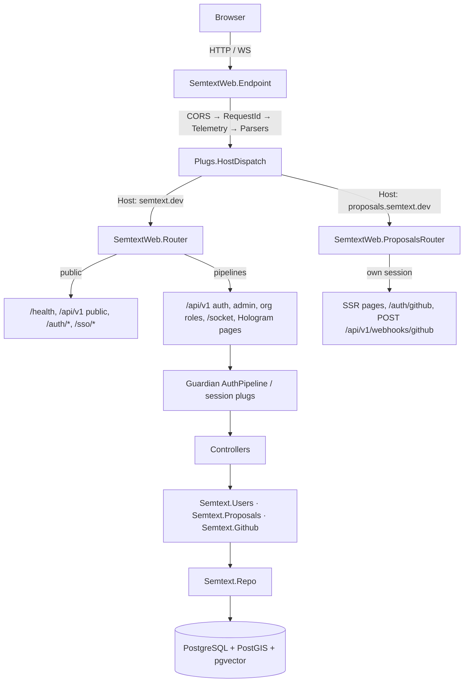

# Project Architecture — semtext/backend

## Overview

Phoenix 1.8 + Hologram backend (OTP app `:semtext`) for the semtext.dev product: JSON API (`/api/v1/*`), isomorphic Hologram UI (pages served by the same host), the proposals pipeline on its own virtual host, and the GitHub Discussions integration. Hydrated from the `hologram-start-app` scaffold (2026-10-14); the start-app platform model (users, orgs, PBAC, media, SSO, workers, consent) carries over.

Bandit HTTP server; Hologram `~HOLO` pages render server-side with client-side Elixir (transpiled). Not API-only — the UI lives in this OTP app.

## System Diagram

## Core Components

| Component | Purpose |
|-----------|---------|
| `Semtext.Application` | OTP supervisor — boots Telemetry, Repo, Migrator, DNSCluster, PubSub, Endpoint, Oban |
| `Semtext.Repo` | Ecto repo — Postgres with UUID primary keys, custom Postgrex types |
| `Semtext.Users` / `Semtext.Organizations` / `Semtext.Projects` / `Semtext.Media` / `Semtext.Authz` | Entity contexts (Noizu Labs Entities) — users, orgs, projects, media, PBAC |
| `Semtext.Auth.*` | Registration, invite gate, smart-token auth/email, SSO domains, roles, current user |
| `Semtext.Proposals` | Proposals domain facade — proposals, versions, moderation, reports, rate limits, discussion links |
| `Semtext.Github` | App JWT/installation tokens, GraphQL v4 client, ports/adapters, webhook body reader |
| `Semtext.Guardian` | JWT token encoding/decoding via Guardian |
| `SemtextWeb.Endpoint` | HTTP entry point — CORS, request parsing (raw-body capture for webhook paths), routing |
| `SemtextWeb.Router` | Main-host routes — public + authenticated + role pipelines + Hologram pages |
| `SemtextWeb.ProposalsRouter` | Proposals-host routes — SSR pages, GitHub OAuth, webhook receiver (own session) |
| `SemtextWeb.Plugs.HostDispatch` | Host-header routing before any router (host isolation) |
| `SemtextWeb.Plugs.CORS` | Custom CORS plug — reflects request origin |

## Authentication Flow

Session-cookie auth for the Hologram UI (host-only cookies; GitHub OAuth on the proposals host) plus Bearer JWT (`Authorization: Bearer <access_token>`) for API clients. Guardian encodes the user as JWT subject; `SemtextWeb.AuthPipeline` verifies and loads the resource on protected routes. Registration supports admin-approval (`pending`) and invite gating; smart tokens cover magic-link email flows; SSO rides OIDC via Authentik (`SSO_DOMAINS`, `SSO_AUTO_APPROVE_DOMAINS`).

## Data Layer

PostgreSQL with custom Postgrex type module (`Semtext.PostgrexTypes`) registering:
- **pgvector** — vector similarity search
- **PostGIS** — spatial data types

UUID primary keys across all tables. Liquibase owns the canonical schema (changelogs 000–031, see [../docs/PROJ-SCHEMA.md](../../docs/PROJ-SCHEMA.md)); Ecto migrations cover smart_token and Oban tables. Ecto migrations run automatically on app boot (skipped in release mode).

## API Routes (main host, selected)

| Method | Path | Auth | Handler |
|--------|------|------|---------|
| GET | `/health` | — | `HealthController.index` |
| GET | `/api/v1/auth/me` | Bearer/session | `AuthController.me` |
| GET/PUT | `/api/v1/consent/cookies` | session | `ConsentController` |
| POST | `/api/v1/media/presign` / `download` / `register` | Bearer | `MediaController` |
| GET | `/api/v1/organizations/:org_id/...` | org role pipelines | org/project/role controllers |
| GET/POST | `/api/v1/groups` · `/policies/check` · `/policies/explain` · `/memberships/*` | session | PBAC controllers |
| GET | `/api/v1/admin/users` · `/organizations` | admin | `AdminController` |
| GET | `/api/v1/agent-kit/tickets|personas|boards` | session | `AgentKitProxyController` |
| GET | `/api/v1/annotate/threads` | session | `AnnotateThreadsController` |
| POST/GET | `/api/v1/driver/run` · `/runs/:id` | — | `DriverController` |
| GET | `/editor/examples/:tag` | — | `EditorExampleController` |
| GET | `/media/:short_id` | short-id scoped | `MediaServeController` |
| GET | `/dev/dashboard` | dev only | Phoenix LiveDashboard |

Proposals host (`ProposalsRouter`): `/` browse, `/p/:slug` detail, `/dashboard`, `/moderation` (moderator-gated), `/auth/github` (+ callback), `/auth/session`, `POST /api/v1/webhooks/github`.

## Background Jobs

Oban queues: `CleanupWorker`, `EmailWorker` (platform); `GithubDiscussionWorker` (discussion create/sync, unique per proposal, 30s→15min backoff), `GithubWebhookWorker` (comment/reaction refresh, idempotent replays).

## Tech Stack

| Layer | Technology |
|-------|-----------|
| Language | Elixir 1.20 / OTP 29 |
| Framework | Phoenix 1.8 + Hologram ~> 0.10 |
| HTTP Server | Bandit |
| Database | PostgreSQL (PostGIS, pgvector) + Liquibase |
| Auth | Guardian (JWT) + bcrypt_elixir + smart_token + OIDC/SAML + GitHub OAuth |
| HTTP clients | Req (+ jose for GitHub App JWT) |
| Entity Framework | Noizu Labs Entities |
| AI/LLM | GenAI (provisioned) |
| Process Registry | Syn (provisioned) |
| Cache | Redis via Redix (provisioned) · Hammer rate limiting |
| Email | Swoosh (local adapter in dev) |
| Telemetry | OpenTelemetry + telemetry_metrics + telemetry_poller + logger_json |

## Deployment

Multi-stage Dockerfile: build on `elixir:1.20.1-otp-29-slim`, produces an OTP release (`rel/semtext`). Runs as `nobody` user. Health check on `/health`. Chart: `../helm/semtext` (ArgoCD; pre-deploy migrate Job).

**Required prod env vars:** `DATABASE_URL`, `SECRET_KEY_BASE`, `SESSION_SIGNING_SALT`, `PHX_HOST` (prod raises on missing signing secrets)

**Optional:** `PHX_SERVER`, `PORT`, `POOL_SIZE`, `DNS_CLUSTER_QUERY`, `OTEL_EXPORTER_OTLP_ENDPOINT`, `FLEET_INGEST_*`, GitHub App/webhook secrets

## Key Decisions

- **One OTP app for UI + API** — Hologram pages and JSON API share the host; no separate frontend
- **Two hosts, one process** — `HostDispatch` before routing; host-only cookies keep sessions disjoint
- **Liquibase owns schema** — Ecto migrations only for smart_token/Oban
- **UUID primary keys** — configured globally via Ecto migration config
- **Custom CORS plug** — reflects request origin rather than allowlisting
- **Auto-migration on boot** — via `Ecto.Migrator` in supervision tree (skipped in releases)
- **Bandit over Cowboy** — Phoenix 1.8 default, pure-Elixir HTTP server
