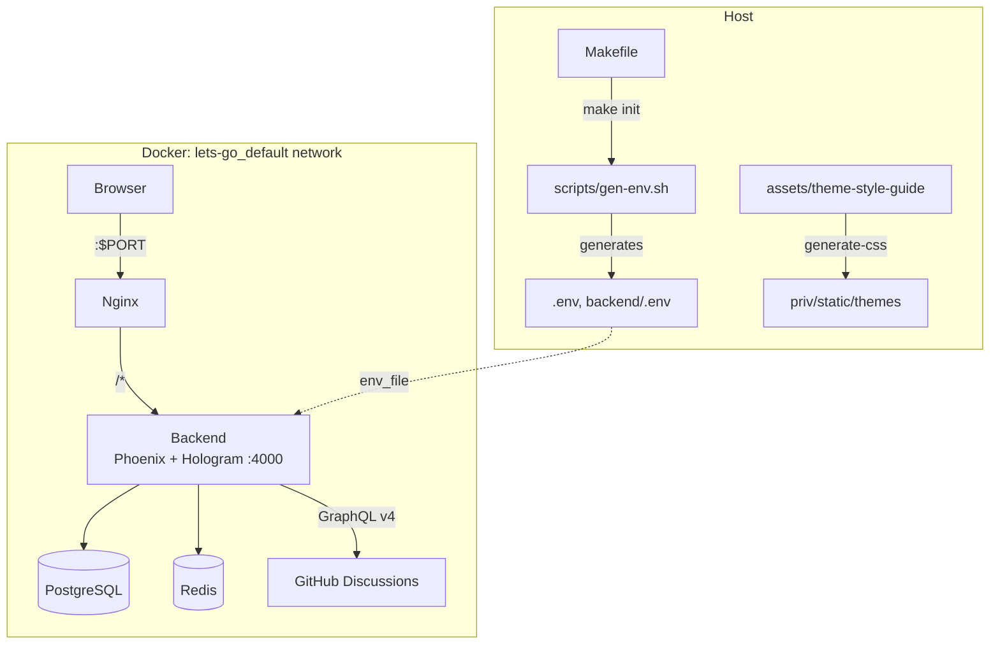

# Architecture — semtext app

Product app of the **semtext.dev** repo (hydrated from the `hologram-start-app` scaffold, 2026-10-14): the SemText showcase/site/docs experience plus the proposals pipeline, as **Hologram** (isomorphic Elixir UI) over a Phoenix 1.8 JSON API. Two Docker containers — **Phoenix + Hologram backend** (`:semtext`), **nginx reverse proxy** — sharing Postgres/Redis on the external Docker network.

One backend, two hosts: `SemtextWeb.Plugs.HostDispatch` dispatches **before** the Hologram router, splitting `semtext.dev` (main site) from `proposals.semtext.dev` (proposal pipeline). Cookies are host-only — the two hosts keep separate sessions by design.

## System Diagram

## Core Components

| Component | Purpose |
|-----------|---------|
| **nginx** | Reverse proxy — all traffic to the unified backend |
| **backend** | Phoenix 1.8 JSON API + Hologram pages/commands (`:semtext`) |
| **Hologram UI (main host)** | `SemtextWeb.Hologram.*` pages — home, docs, reference (index / per-element / all-tags), editor island, showcase suite, style guide, themes, admin/org dashboards; auth middleware (`require_auth`, `require_admin`) |
| **Proposals host** | `SemtextWeb.ProposalsRouter` on `proposals.semtext.dev` — own session, GitHub OAuth login, browse/dashboard/moderation pages via `Pages.Proposals.PageRelay` (SSR) |
| **Proposals domain** | `Semtext.Proposals` context — proposals, versions, discussion links, moderation, reports, rate limits (see [PROJ-SCHEMA.md](PROJ-SCHEMA.md)) |
| **GitHub sync** | `Semtext.Github` — App JWT/installation tokens, GraphQL discussion create/sync, inbound webhook receiver, Oban workers |
| **PBAC engine** | Group/scoped-membership + JSONB policy authorization, evaluated in-database (see [PROJ-SCHEMA.md](PROJ-SCHEMA.md)) |
| **Auth stack** | Guardian JWT (API), Hologram session (UI), smart tokens (email/magic link), SSO (OIDC via Authentik, domain policy via `SSO_DOMAINS`), GitHub OAuth (proposals host) |
| **Workers** | Oban jobs — `CleanupWorker`, `EmailWorker`, `GithubDiscussionWorker`, `GithubWebhookWorker`; outbound webhooks via `Semtext.Events.WebhookHandler` |
| **Media pipeline** | Upload → transform (`Semtext.Media.Transform`, ex_aws/vix) → variants cache; short-id + visibility scoping |
| **Proxy lanes** | `/api/v1/agent-kit/*` (agent-kit MCP proxy), `/api/v1/annotate/*` (annotate threads), `/api/v1/driver/*` (spec test driver), live-fetch proxy |
| **Makefile** | Build orchestration and project identity |

## Request Routing

nginx proxies `/socket` (WebSocket, Hologram client runtime) and `/` to the backend; `/otel/` goes to the OTLP collector. Within Phoenix:

| Pattern | Host | Destination | Notes |
|---------|------|-------------|-------|
| `/health`, `/api/v1/*` | main | `SemtextWeb.Router` | JSON API — consent, auth/me, users, media, invites, orgs/projects/roles, groups/memberships/policies (+ `check`/`explain`), admin, agent-kit, annotate, driver, editor examples |
| `/auth/*` (OIDC/OAuth), `/sso/*` | main | `SemtextWeb.Router` | SSO redirect flows + code exchange |
| `/api/v1/webhooks/github` | proposals | `GithubWebhookController` | Inbound GitHub App webhook (constant-time HMAC over raw body, two-layer replay dedupe) |
| `/auth/github` (+ callback), `/auth/session`, `/`, `/p/:slug`, `/dashboard`, `/moderation`, `/hologram/*` | proposals | `SemtextWeb.ProposalsRouter` | Proposals pages (SSR via `PageRelay`) + own-session auth |
| `/media/:short_id` | main | `MediaServeController` | Short-id scoped media reads |
| `/socket` | main | `UserSocket` | Hologram client runtime channel |
| `/themes/*`, `/twp/*`, static | main | Plug.Static | Design-system CSS + Tailwind Plus demos |
| `/*` | main | `Hologram.Router` | Pages (see README for the page map) |

`HostDispatch` routes by Host header before any router; the main host 404s proposals paths (`HostGuard` page middleware) and vice versa. Plugs apply auth pipelines, CORS, rate limiting (Hammer), and OTel logger metadata; Hologram pages gate on `require_auth`/`require_admin` (proposals: `require_user`/`require_moderator`).

## Client / Server Boundary (Hologram)

| Concern | Client (`action/3`) | Server (`command/3` / `init/3`) |
|---------|---------------------|----------------------------------|
| Form field edits, step transitions | yes | — |
| Login / register / profile save | optimistic UI only | Guardian + Users domain |
| SSO catalog, current user | seeded in `init` | session + DB |
| Cookie consent | banner visibility | session write |

Auth tokens for the Hologram UI live in the **Hologram/Phoenix session** (host-only cookies). The JSON API continues to accept Bearer JWT for external clients.

## Design System

- Theme YAML: `assets/theme-style-guide/` (canonical) + `backend/themes/theme-*/` (runtime-discovered themes)
- Generated CSS: `backend/priv/static/themes/` (`make regen` via `assets/scripts/generate-css.ts` + `@noizu/styleguide`)
- Components map 1:1 to styleguide React primitives (`Btn` → `StyleGuideBtn`, etc.) using semantic classes (`btn`, `card`, …)
- Interactive viewer at `/styleguide` (+ `/styleguide/tailwind-plus`) — component browser, color palettes, shell layouts
- **tobor-kit Hologram mirror**: path dep `:tobor_kit_hologram` (Lit → native Hologram component kit from `Portfolio/Libs/tobor-kit/hologram`); browser verification page at `/tk-smoke` (stateless + stateful mirrors, event-forward contract) with `tobor-kit.css` linked in the main layout

## Authorization (PBAC)

Access control is policy-based: users/groups hold `scoped_memberships` on resources (organization | project); groups attach JSONB `policies` (IAM-style statements). Evaluation runs in-database (`check_user_permission` PL/pgSQL, deny-overrides-allow, wildcard + template matching); `/api/v1/policies/check` + `explain` expose the engine over the API. Per-org `custom_roles` extend the system groups. Legacy flat `memberships` were migrated in changeset 021.

## Background & Events

Oban-backed workers (`CleanupWorker`, `EmailWorker`, `GithubDiscussionWorker`, `GithubWebhookWorker`) handle cleanup, mail, and GitHub discussion create/sync (forced-outage retries, idempotent webhook replays); outbound `webhooks` deliver org events via `Semtext.Events.WebhookHandler`. Redis backs rate limiting and runtime coordination (`Semtext.Redis`).

## Observability

OpenTelemetry instrumentation (OTLP via nginx `/otel/` → SigNoz collector) with JSON logging (`logger_json`), `Plugs.OtelLoggerMetadata` (trace/span ids in request logs), and a FleetPush daily metrics worker (`Semtext.FleetPush`). See [OBSERVABILITY.md](../OBSERVABILITY.md).

## Deployment

Local/dev: docker-compose (`.dev.yaml` hot reload, `mix holo` requires `HOLOGRAM_START=1` — pages 404 without it; port overlay maps host 8080). Production: `helm/semtext` chart (ArgoCD auto-sync) with pre-deploy `migrate-job`, Infisical-sourced secrets/TLS (`semtext-dev-tls` for `semtext.dev` / `www.semtext.dev` / `proposals.semtext.dev`; separate `semtext-live-dev-tls` + `dev.semtext.dev` for the live-dev lane), HPA/PDB. Release path is git-driven (merge to main → CI builds `sha-*` images → `bump-chart` → Argo syncs). The repo also ships the pre-replatform static surface (root `Dockerfile` + `nginx.conf`: Next.js landing at `/`, showcase under `/site/`, `/demo/`, `/spec/`).

## Technology Stack

| Layer | Choice |
|-------|--------|
| UI | Hologram ~> 0.10, Elixir transpiled to JS |
| API | Phoenix 1.8, Bandit, Guardian JWT |
| Database | PostgreSQL (PostGIS, pgvector) + Liquibase |
| Cache | Redis |
| Jobs | Oban |
| Auth | Guardian + smart_token + Ueberauth/OIDC/SAML SSO + GitHub OAuth |
| Design | @noizu/styleguide CSS tokens |
| Observability | OpenTelemetry + logger_json |
| Proxy | Nginx |
| Orchestration | Docker Compose + Helm (ArgoCD) |

→ *Backend internals: [backend/docs/PROJ-ARCH.md](../backend/docs/PROJ-ARCH.md) · Schema: [PROJ-SCHEMA.md](PROJ-SCHEMA.md) · Scaffolding (historical): [SCAFFOLDING.md](SCAFFOLDING.md)*
