# Database Schema & Data Artifacts — semtext app

Schema for the semtext.dev product app (hydrated from the start-app Hologram scaffold). Managed by Liquibase YAML changelogs (`backend/db/changelog/`, changesets 000–031) applied via `mix liquibase.update` / `make migrate`; a small Ecto-migration lane exists for `smart_token` and Oban tables. All tables use UUID primary keys and `timestamptz` timestamps with `now()` defaults; modification timestamps are always `updated_at`.

Detailed domain breakdowns live under [`schema/`](schema/):

| File | Domain |
|------|--------|
| [schema/core-versioned.md](schema/core-versioned.md) | Seed helper, versioned strings/names/descriptions |
| [schema/users-auth-media.md](schema/users-auth-media.md) | Users, credentials, sessions, auth providers, media, media variants, invite tokens + redemptions |
| [schema/orgs-pbac.md](schema/orgs-pbac.md) | Organizations, legacy memberships, groups/hierarchy, scoped memberships, policies, custom roles, stored procedures, PBAC seeds |
| [schema/apps-consent.md](schema/apps-consent.md) | Webhooks, projects, cookie consents |
| [schema/proposals-github.md](schema/proposals-github.md) | Proposals, proposal versions, discussion links, moderation events, reports, rate limits, GitHub webhook deliveries |
| [schema/config-artifacts.md](schema/config-artifacts.md) | Non-SQL persistence/config artifacts (scaffold hydration manifest, env structure, theme YAML format, Helm values, generated CSS) |

## Extensions

| Extension | Purpose |
|-----------|---------|
| citext | Case-insensitive text (emails, usernames, slugs) |
| uuid-ossp | UUID generation |
| postgis | Geospatial queries |
| vector | pgvector embeddings |
| cube | Multi-dimensional indexing (used by earthdistance) |
| pg_trgm | Trigram similarity search |
| earthdistance | Geographic distance calculations |

## Enum Types

| Enum | Values |
|------|--------|
| `status_enum` | active, disabled, suspended, deleted, other |
| `user_status_enum` | active, unverified, waitlist, pending, suspended, deleted, other (`pending` added in 025) |
| `credential_status_enum` | active, disabled, suspended, deleted, other |
| `session_status_enum` | active, revoked, disabled, suspended, deleted, other |
| `media_type_enum` | image, video, audio, document, other |
| `file_type_enum` | jpg, jpeg, png, gif, webp, svg, bmp, ico, tiff, mp4, avi, mov, webm, mp3, wav, ogg, pdf, doc, other |
| `owner_type_enum` | user, organization, other |
| `credential_type_enum` | login, oauth, smart_link, other |
| `device_type_enum` | web, ios, android, other |
| `member_type_enum` | user, group (013) |
| `resource_type_enum` | organization, project (013) |
| `role_name_enum` | owner, admin, member, viewer (013) |
| `proposal_status_enum` | draft, submitted, under_review, accepted, declined, merged, withdrawn (028) |
| `discussion_state_enum` | pending, ok, failed (028); `removed` added in 031 |
| `moderation_event_enum` | status_change, hide, unhide, report, spam_flag, lock_discussion, claim (028) |
| `report_reason_enum` | spam, harassment, other (028) |
| `report_status_enum` | open, resolved, dismissed (028) |

## ERD — Mermaid

```mermaid
erDiagram
    users ||--o| versioned_names : "name_id"
    users ||--o| versioned_descriptions : "description_id"
    users ||--o{ user_credentials : "has many"
    users ||--o{ user_sessions : "has many"
    users ||--o{ user_media : "has many"
    users ||--o{ scoped_memberships : "member of resources"
    users ||--o{ user_policies : "direct policies"
    users ||--o{ invite_token_redemptions : "redeems"
    users ||--o{ cookie_consents : "consent"
    users ||--o{ proposals : "submits"

    user_credentials }o--|| auth_providers : "uses"
    user_credentials ||--o{ user_sessions : "creates"
    user_media }o--|| media : "references"
    media ||--o{ media_variants : "has variants"

    organizations ||--o{ projects : "has many"
    organizations ||--o{ custom_roles : "has many"
    organizations ||--o{ webhooks : "has many"
    organizations ||--o{ invite_tokens : "scoped to"
    invite_tokens ||--o{ invite_token_redemptions : "redeemed via"

    groups ||--o{ group_hierarchy : "ancestor/descendant"
    groups ||--o{ scoped_memberships : "grants via"
    groups ||--o{ group_policies : "attaches"
    policies ||--o{ group_policies : "attached by"
    policies ||--o{ user_policies : "attached by"
    custom_roles ||--o{ custom_role_permissions : "has permissions"

    proposals ||--o{ proposal_versions : "has versions"
    proposals ||--o| discussion_links : "discussion sync"
    proposals ||--o{ moderation_events : "moderated via"
    proposals ||--o{ proposal_reports : "reported via"
    proposals ||--o{ proposals : "forked from"

    versioned_strings {
        UUID id PK
        TEXT content
    }
    versioned_names {
        UUID id PK
        VARCHAR_255 first
        TEXT_ARRAY middle
        VARCHAR_255 last
    }
    versioned_descriptions {
        UUID id PK
        VARCHAR_255 title
        TEXT body
    }
    auth_providers {
        UUID id PK
        VARCHAR_255 title
        TEXT settings
    }
    users {
        UUID id PK
        CITEXT email
        user_status_enum status
        BOOLEAN admin
        BOOLEAN verified
        UUID invite_token_id FK
        CITEXT github_login
        SMALLINT trust_tier
        CITEXT role
    }
    user_credentials {
        UUID id PK
        UUID user_id FK
        UUID auth_provider_id FK
        credential_status_enum status
    }
    user_sessions {
        UUID id PK
        UUID user_id FK
        UUID credential_id FK
        session_status_enum status
    }
    media {
        UUID id PK
        media_type_enum media_type
        file_type_enum file_type
        VARCHAR_12 short_id
        VARCHAR_20 visibility
        resource_type_enum owner_type
        UUID owner_id
    }
    media_variants {
        UUID id PK
        UUID media_id FK
        VARCHAR_200 params
        BIGINT file_size
    }
    user_media {
        UUID id PK
        UUID user_id FK
        UUID media_id FK
    }
    organizations {
        UUID id PK
        CITEXT slug
        VARCHAR_255 name
    }
    memberships_legacy {
        UUID id PK
        UUID organization_id FK
        UUID user_id FK
        VARCHAR_50 role
    }
    groups {
        UUID id PK
        role_name_enum name
        VARCHAR_200 display_name
        BOOLEAN is_system
    }
    group_hierarchy {
        UUID ancestor_id FK
        UUID descendant_id FK
        INTEGER depth
    }
    scoped_memberships {
        UUID id PK
        UUID group_id FK
        resource_type_enum resource_type
        UUID resource_id
        member_type_enum member_type
        UUID member_id
        TIMESTAMPTZ expires_at
    }
    policies {
        UUID id PK
        VARCHAR_100 name
        JSONB policy_document
        BOOLEAN is_active
    }
    group_policies {
        UUID id PK
        UUID group_id FK
        UUID policy_id FK
        INTEGER priority
    }
    user_policies {
        UUID id PK
        UUID user_id FK
        UUID policy_id FK
        resource_type_enum resource_type
        UUID resource_id
    }
    custom_roles {
        UUID id PK
        UUID organization_id FK
        VARCHAR_100 name
    }
    custom_role_permissions {
        UUID id PK
        UUID role_id FK
        VARCHAR_200 permission
    }
    projects {
        UUID id PK
        UUID organization_id FK
        CITEXT slug
        VARCHAR_20 status
    }
    webhooks {
        UUID id PK
        UUID organization_id FK
        VARCHAR_2048 url
        TEXT_ARRAY events
        BOOLEAN active
    }
    invite_tokens {
        UUID id PK
        UUID organization_id FK
        VARCHAR_255 token_hash
        VARCHAR_20 status
        TIMESTAMPTZ starts_at
        TIMESTAMPTZ expires_at
    }
    invite_token_redemptions {
        UUID id PK
        UUID invite_token_id FK
        UUID user_id FK
        TIMESTAMPTZ redeemed_at
    }
    cookie_consents {
        UUID id PK
        UUID user_id FK
        UUID browser_session_id
        INTEGER version
        JSONB categories
    }
    proposals {
        UUID id PK
        CITEXT slug
        proposal_status_enum status
        UUID current_version_id FK
        UUID forked_from_proposal_id FK
        UUID submitter_id FK
        TSVECTOR search
    }
    proposal_versions {
        UUID id PK
        UUID proposal_id FK
        INTEGER version
        JSONB options
        JSONB files
        TEXT files_sha256
    }
    discussion_links {
        UUID id PK
        UUID proposal_id FK
        TEXT repo
        INTEGER discussion_number
        discussion_state_enum state
    }
    moderation_events {
        UUID id PK
        UUID proposal_id FK
        UUID actor_user_id FK
        moderation_event_enum event
    }
    proposal_reports {
        UUID id PK
        UUID proposal_id FK
        UUID reporter_id FK
        report_reason_enum reason
        report_status_enum status
    }
    rate_limit_events {
        UUID id PK
        TEXT bucket
        TEXT subject
    }
    github_webhook_deliveries {
        UUID id PK
        TEXT delivery_id
        TEXT event
    }
```

## ERD — PlantUML

```plantuml
@startuml
!define TABLE(name) entity name <<(T,#FFAAAA)>>
skinparam linetype ortho

package "Versioned Entities" {
  TABLE(versioned_strings) {
    * id : UUID <<PK>>
    --
    content : TEXT
  }
  TABLE(versioned_names) {
    * id : UUID <<PK>>
    --
    first : VARCHAR(255)
    middle : TEXT[]
    last : VARCHAR(255)
  }
  TABLE(versioned_descriptions) {
    * id : UUID <<PK>>
    --
    title : VARCHAR(255)
    body : TEXT
  }
}

package "Users & Auth" {
  TABLE(users) {
    * id : UUID <<PK>>
    --
    * email : CITEXT <<UNIQUE>>
    * status : user_status_enum
    * admin : BOOLEAN
    name_id : UUID <<FK>>
    description_id : UUID <<FK>>
    invite_token_id : UUID <<FK>>
    github_login : CITEXT
    trust_tier : SMALLINT
    role : CITEXT
  }
  TABLE(auth_providers) {
    * id : UUID <<PK>>
    --
    title : VARCHAR(255)
    settings : TEXT
  }
  TABLE(user_credentials) {
    * id : UUID <<PK>>
    --
    * user_id : UUID <<FK>>
    * auth_provider_id : UUID <<FK>>
    * status : credential_status_enum
  }
  TABLE(user_sessions) {
    * id : UUID <<PK>>
    --
    * user_id : UUID <<FK>>
    credential_id : UUID <<FK>>
    * status : session_status_enum
  }
}

package "Media" {
  TABLE(media) {
    * id : UUID <<PK>>
    --
    * media_type : media_type_enum
    * file_type : file_type_enum
    * short_id : VARCHAR(12) <<UNIQUE>>
    * visibility : VARCHAR(20)
    owner_type : resource_type_enum
    owner_id : UUID
  }
  TABLE(media_variants) {
    * id : UUID <<PK>>
    --
    * media_id : UUID <<FK>>
    * params : VARCHAR(200)
    file_size : BIGINT
  }
  TABLE(user_media) {
    * id : UUID <<PK>>
    --
    * user_id : UUID <<FK>>
    * media_id : UUID <<FK>>
  }
}

package "Organizations" {
  TABLE(organizations) {
    * id : UUID <<PK>>
    --
    * slug : CITEXT <<UNIQUE>>
    * name : VARCHAR(255)
  }
  TABLE(memberships_legacy) {
    * id : UUID <<PK>>
    --
    * organization_id : UUID <<FK>>
    * user_id : UUID <<FK>>
    * role : VARCHAR(50)
  }
  TABLE(projects) {
    * id : UUID <<PK>>
    --
    * organization_id : UUID <<FK>>
    * slug : CITEXT
    * status : VARCHAR(20)
  }
  TABLE(webhooks) {
    * id : UUID <<PK>>
    --
    organization_id : UUID <<FK>>
    * url : VARCHAR(2048)
    * active : BOOLEAN
  }
  TABLE(invite_tokens) {
    * id : UUID <<PK>>
    --
    organization_id : UUID <<FK>>
    * token_hash : VARCHAR(255) <<UNIQUE>>
    * status : VARCHAR(20)
    starts_at : TIMESTAMPTZ
    expires_at : TIMESTAMPTZ
  }
  TABLE(invite_token_redemptions) {
    * id : UUID <<PK>>
    --
    * invite_token_id : UUID <<FK>>
    * user_id : UUID <<FK>>
    * redeemed_at : TIMESTAMPTZ
  }
  TABLE(custom_roles) {
    * id : UUID <<PK>>
    --
    * organization_id : UUID <<FK>>
    * name : VARCHAR(100)
  }
  TABLE(custom_role_permissions) {
    * id : UUID <<PK>>
    --
    * role_id : UUID <<FK>>
    * permission : VARCHAR(200)
  }
}

package "PBAC" {
  TABLE(groups) {
    * id : UUID <<PK>>
    --
    * name : role_name_enum <<UNIQUE>>
    * display_name : VARCHAR(200)
    * is_system : BOOLEAN
  }
  TABLE(group_hierarchy) {
    ancestor_id : UUID <<FK>>
    descendant_id : UUID <<FK>>
    --
    * depth : INTEGER
  }
  TABLE(scoped_memberships) {
    * id : UUID <<PK>>
    --
    * group_id : UUID <<FK>>
    * resource_type : resource_type_enum
    * resource_id : UUID
    * member_type : member_type_enum
    * member_id : UUID
    expires_at : TIMESTAMPTZ
  }
  TABLE(policies) {
    * id : UUID <<PK>>
    --
    * name : VARCHAR(100) <<UNIQUE>>
    * policy_document : JSONB
    * is_active : BOOLEAN
  }
  TABLE(group_policies) {
    * id : UUID <<PK>>
    --
    * group_id : UUID <<FK>>
    * policy_id : UUID <<FK>>
    * priority : INTEGER
  }
  TABLE(user_policies) {
    * id : UUID <<PK>>
    --
    * user_id : UUID <<FK>>
    * policy_id : UUID <<FK>>
    resource_type : resource_type_enum
    resource_id : UUID
  }
}

package "Consent" {
  TABLE(cookie_consents) {
    * id : UUID <<PK>>
    --
    user_id : UUID <<FK>>
    browser_session_id : UUID
    * version : INTEGER
    * categories : JSONB
  }
}

package "Proposals & GitHub" {
  TABLE(proposals) {
    * id : UUID <<PK>>
    --
    * slug : CITEXT <<UNIQUE>>
    * element_tag : TEXT
    * title : TEXT
    * status : proposal_status_enum
    current_version_id : UUID <<FK>>
    forked_from_proposal_id : UUID <<FK>>
    * submitter_id : UUID <<FK>>
    idempotency_key : TEXT <<UNIQUE>>
    hidden_at : TIMESTAMPTZ
    search : TSVECTOR (generated)
  }
  TABLE(proposal_versions) {
    * id : UUID <<PK>>
    --
    * proposal_id : UUID <<FK>>
    * version : INTEGER
    * files : JSONB
    * files_sha256 : TEXT
    created_by_id : UUID <<FK>>
  }
  TABLE(discussion_links) {
    * id : UUID <<PK>>
    --
    * proposal_id : UUID <<FK>> <<UNIQUE>>
    * repo : TEXT
    discussion_number : INTEGER
    * state : discussion_state_enum
  }
  TABLE(moderation_events) {
    * id : UUID <<PK>>
    --
    * proposal_id : UUID <<FK>>
    actor_user_id : UUID <<FK>>
    * event : moderation_event_enum
  }
  TABLE(proposal_reports) {
    * id : UUID <<PK>>
    --
    * proposal_id : UUID <<FK>>
    reporter_id : UUID <<FK>>
    * reason : report_reason_enum
    * status : report_status_enum
  }
  TABLE(rate_limit_events) {
    * id : UUID <<PK>>
    --
    * bucket : TEXT
    * subject : TEXT
  }
  TABLE(github_webhook_deliveries) {
    * id : UUID <<PK>>
    --
    * delivery_id : TEXT <<UNIQUE>>
    event : TEXT
  }
}

users }o--o| versioned_names : "name_id"
users }o--o| versioned_descriptions : "description_id"
users ||--o{ user_credentials : "has many"
users ||--o{ user_sessions : "has many"
users ||--o{ user_media : "has many"
users ||--o{ scoped_memberships : "member of resources"
users ||--o{ user_policies : "direct policies"
users ||--o{ invite_token_redemptions : "redeems"
users ||--o{ cookie_consents : "consent"
users ||--o{ proposals : "submits"

user_credentials }o--|| auth_providers : "uses"
user_credentials ||--o{ user_sessions : "creates"
user_media }o--|| media : "references"
media ||--o{ media_variants : "has variants"

organizations ||--o{ projects : "has many"
organizations ||--o{ custom_roles : "has many"
organizations ||--o{ webhooks : "has many"
organizations ||--o{ invite_tokens : "scoped to"
invite_tokens ||--o{ invite_token_redemptions : "redeemed via"

groups ||--o{ scoped_memberships : "grants via"
groups ||--o{ group_policies : "attaches"
policies ||--o{ group_policies : "attached by"
policies ||--o{ user_policies : "attached by"
custom_roles ||--o{ custom_role_permissions : "has permissions"

proposals ||--o{ proposal_versions : "has versions"
proposals ||--o| discussion_links : "discussion sync"
proposals ||--o{ moderation_events : "moderated via"
proposals ||--o{ proposal_reports : "reported via"
proposals ||--o{ proposals : "forked from"
@enduml
```

## Changeset Reference

| Changeset | File | Tables/Objects |
|-----------|------|----------------|
| 000 | extensions | citext, uuid-ossp, postgis, vector, cube, pg_trgm, earthdistance |
| 001 | enums | 9 base enum types |
| 002 | seed-helper | seed_helper_records |
| 003 | versioned-entities | versioned_strings, versioned_names, versioned_descriptions |
| 004 | auth-providers | auth_providers |
| 005 | media | media |
| 006 | users | users + 3 unique indexes |
| 007 | user-media | user_media + 1 index |
| 008 | credentials-sessions | user_credentials, user_sessions + indexes |
| 009 | organizations | organizations, memberships + unique constraint |
| 010 | invite-tokens | invite_tokens + 2 indexes |
| 011 | webhooks | webhooks + org/active index |
| 012 | admin-flag | users.admin column |
| 013 | pbac-enums | member_type_enum, resource_type_enum, role_name_enum |
| 014 | pbac-groups | groups, group_hierarchy (+ triggers) |
| 015 | pbac-scoped-memberships | scoped_memberships (+ covering/partial indexes, cascade-org-removal trigger) |
| 016 | pbac-policies | policies (GIN index), group_policies, user_policies |
| 017 | projects | projects + partial covering index |
| 018 | custom-roles | custom_roles, custom_role_permissions |
| 019 | pbac-stored-procedures | check_user_permission, add_scoped_member, update_scoped_member_role, remove_scoped_member_safe, get_user_role_in_resource, list_user_accessible_projects |
| 020 | pbac-seed-data | system groups (owner/admin/member/viewer) + system policies (super-admin, owner, admin, member, viewer) |
| 021 | migrate-memberships-to-pbac | memberships → scoped_memberships migration; original table renamed memberships_legacy |
| 022 | enhance-invitations | invite_tokens.status/accepted_by/accepted_at + backfill |
| 023 | media-visibility-and-short-id | media.short_id (unique), visibility CHECK ('public','private','org'), owner_type/owner_id + partial index, generate_media_short_id() |
| 024 | media-variants-cache | media_variants |
| 025 | auth-registration-consent | user_status_enum += 'pending'; users registration/approval columns; invite_tokens.starts_at/redemption_count; invite_token_redemptions; cookie_consents |
| 026 | invite-role | invite_tokens.role column |
| 027 | invite-redemption-unique-per-user | unique constraint on invite_token_redemptions (invite_token_id, user_id) |
| 028 | proposals-enums | proposal_status_enum, discussion_state_enum, moderation_event_enum, report_reason_enum, report_status_enum |
| 029 | proposals-tables | users GitHub columns (github_login, trust_tier, role); view_submitters view; proposals, proposal_versions, discussion_links, moderation_events, proposal_reports, rate_limit_events, github_webhook_deliveries (+ FKs) |
| 030 | proposals-indexes | proposals list/search/tag/fork/submitter/idempotency indexes, version constraints, discussion-links unique (repo, number), moderation/report/rate-limit/webhook-delivery indexes |
| 031 | discussion-removed-state | discussion_state_enum += 'removed' |

## Non-Liquibase Migrations

Ecto migrations in `backend/priv/repo/migrations/` (applied by the release migrator, complements Liquibase):

| Migration | Objects |
|-----------|---------|
| 20241112215020_setup_smart_token | smart_token support (credentials of type smart_link) |
| 20260526000000_add_oban_tables | oban_jobs + Oban support tables |
| 20260527000000_update_oban_to_v14 | Oban v14 index/state updates |

Oban queue tables back the `Semtext.Workers` (cleanup, email, github discussion/webhook) — see `backend/lib/semtext/workers/`.
