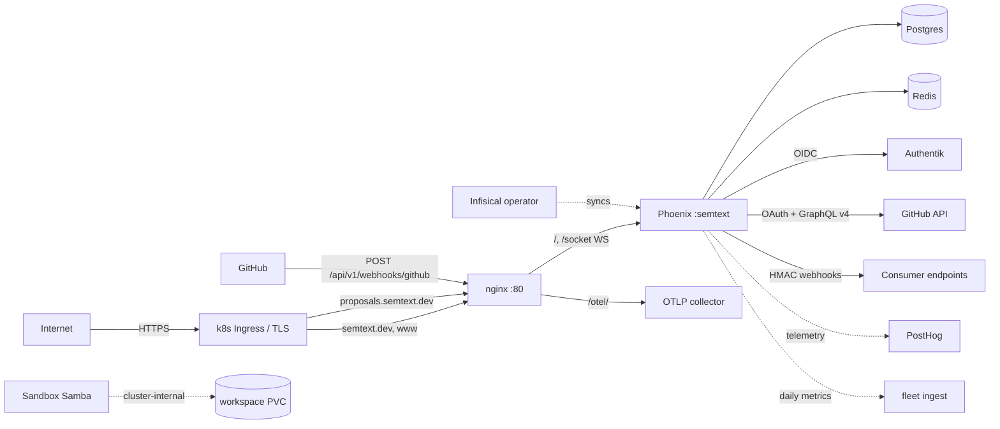

# Threat Model — semtext app

<!-- 〚📁:8178a490-1ba0-5c89-9dd8-3fb00fde5b4b〛 THREAT-MODEL :: Threat model — trust boundaries, attack surface, vulnerability register T-001..T-012. -->

Security counterpart to [PROJ-ARCH.md](PROJ-ARCH.md). Scope: the two-container stack (Phoenix + Hologram backend `:semtext`, nginx reverse proxy) serving **two hosts** (`semtext.dev` + `www.semtext.dev` main site, `proposals.semtext.dev` proposals pipeline), its auth/authz stack, media pipeline, GitHub integration (OAuth login, GraphQL egress, inbound App webhook), sandbox lane, and the Helm-deployed perimeter. Structure map: [PROJ-LAYOUT.md](PROJ-LAYOUT.md). The app was hydrated from the `hologram-start-app` scaffold (2026-10-14) and inherited its controls; product-era additions (proposals, GitHub, proxy lanes) are modeled on their own merits below.

## Trust Boundaries

1. **Internet → edge**: TLS terminates at the k8s ingress (`tls.secretName: semtext-dev-tls`, Infisical-sourced) for `semtext.dev`, `www.semtext.dev`, and `proposals.semtext.dev`; nginx listens on :80 inside the cluster. A separate live-dev lane runs at `dev.semtext.dev` with `semtext-live-dev-tls`. Local docker-compose runs plain HTTP on host :8080 — dev only.
2. **Edge → backend process**: nginx proxies `/` and `/socket` (WebSocket) to Phoenix :4000, and `/otel/` to the OTLP collector. nginx adds no auth of its own.
3. **Host isolation (in-process)**: `SemtextWeb.Plugs.HostDispatch` routes by Host header **before** any router; cookies carry no `Domain=` attribute (host-only), so the main-site and proposals sessions are disjoint. `HostGuard` 404s cross-host page resolution.
4. **Internet → GitHub webhook**: `POST /api/v1/webhooks/github` (proposals host) accepts unsigned-by-TLS-delivery GitHub App events; trust is the shared `X-Hub-Signature-256` HMAC secret.
5. **Backend → stores**: credentialed Postgres/Redis on the shared external Docker network (isolation by credentials, not network).
6. **Cluster → sandbox lane**: separate sandbox deployment (Samba/supervisord, writable workspace PVC) with its own values file.
7. **Process → third parties**: OIDC/Authentik SSO, GitHub OAuth + GraphQL v4 (App JWT/installation tokens), SMTP egress (EmailWorker), outbound webhook delivery, PostHog analytics (`us.i.posthog.com`), fleet-dashboard metrics ingest, agent-kit MCP proxy upstream.

Crown jewels: the Postgres data (users, credential hashes, PBAC policies, media metadata, proposals + moderation records), session/JWT signing secrets, the GitHub webhook/App-private-key secrets, and webhook signing secrets.

## Attack Surface

Entry points: all Hologram pages on both hosts (`/*` via `Hologram.Router` / `ProposalsRouter` — home, docs, reference, editor island, showcase, styleguide, `/tk-smoke`, proposals browse/dashboard/moderation), `/api/v1/*` JSON (Bearer JWT or session) incl. agent-kit/annotate/driver proxy lanes, `/auth/*` + `/sso/*` OIDC flows + `/auth/github` OAuth, `POST /api/v1/webhooks/github`, `/socket` channel, `/media/:short_id`, `/otel/` proxy, `/nginx-health`, sandbox SMB.

## Vulnerability Register

| ID | Severity | STRIDE | Component | Status |
|----|----------|--------|-----------|--------|
| T-001 | High | Spoofing | SSO e-mail-domain identity trust (`SSO_DOMAINS`, `SSO_AUTO_APPROVE_DOMAINS`) | Mitigated — domain allowlist + `pending` admin-approval default for unknown domains; auto-approve is opt-in |
| T-002 | High | Elevation | PBAC JSONB policies with wildcard/template matching (PL/pgSQL) | Partial — deny-overrides-allow, in-DB evaluation; an overly broad wildcard policy is a config error the engine will honor |
| T-003 | Medium | Spoofing | Credential stuffing / brute force on auth endpoints | Mitigated — Hammer rate limiting (`rate_limited_auth`, `rate_limited_sensitive` pipelines) |
| T-004 | Medium | Tampering | Outbound webhooks unsigned when `webhook.secret` is nil (`webhook.secret \|\| ""`) | Partial — HMAC-SHA256 `x-webhook-signature` when secret set; receivers must verify, empty-secret fallback signs with "" |
| T-005 | Medium | DoS / Info | `/otel/` proxy forwards unauthenticated browser RUM traces to collector | Open — collector accepts arbitrary trace ingestion from anyone who can reach the edge |
| T-006 | Medium | Tampering | Media upload → `Transform` (vix/ex_aws) | Partial — format/content-type mapping in transform; visibility + short-id scoping on reads |
| T-007 | High | Elevation | Sandbox lane Samba share (writable `/workspace`, `force user = dev`) | Mitigated — cluster-internal service, `security = user`, `map to guest = Never`, SMB2 minimum, `valid users = dev`; residual = strength of generated `dev` credential |
| T-008 | Low | Info disclosure | Structured JSON logging + OTel metadata may carry PII | Partial — `logger_json` + `Plugs.OtelLoggerMetadata`; no documented PII scrubbing policy |
| T-009 | Medium | DoS | Single backend behind nginx; WebSocket churn | Partial — HPA + PDB in chart; no explicit connection/queue limits |
| T-010 | Low | Tampering | Supply chain: `:tobor_kit_hologram` monorepo path dependency | Mitigated — path dep resolved inside the monorepo (not fetched); TODO noted in mix.exs to pin as git dep when productized |
| T-011 | Medium | Spoofing/Tampering | Inbound GitHub App webhook (`POST /api/v1/webhooks/github`) | Mitigated — constant-time `X-Hub-Signature-256` verify over the RAW body before any trust (body captured only for `/api/v1/webhooks/**` paths); two-layer replay dedupe (`github_webhook_deliveries` table + Oban unique on delivery id); missing/unset secret answers 503 (misconfiguration, not caller error) |
| T-012 | Low | Spoofing | Cross-host session confusion (main site vs proposals host) | Mitigated — host-only cookies (no `Domain=`), `HostDispatch` before routing, `HostGuard` 404s cross-host page resolution, separate auth scopes |

Session security (cross-cutting): SSO flow cookie is signed, `SameSite=Lax`, 900 s max-age, and fails closed to `state_mismatch` on timeout/tamper; Hologram UI tokens live in the Phoenix session (host-scoped), API uses Guardian JWT from `runtime.exs` secrets. Prod raises on missing `SECRET_KEY_BASE` / `SESSION_SIGNING_SALT`; dev/test values are per-boot generated. Production reads real secrets at runtime (Infisical → k8s Secret). Proposals-host moderation gates on `users.role == "moderator"` (`require_moderator` plug).

## Mitigation Coverage

7 mitigated · 4 partial · 1 open. The open item (T-005) and partials (T-002, T-004, T-006, T-008, T-009) are inherited template-era decisions; re-rate each if the exposure profile changes (e.g. multi-tenant collector, public webhook consumers).

## Residual Risk

- **Shared external Docker network**: infra isolation is credential-based; a compromised peer container can reach Postgres/Redis ports. Accepted for the dev topology; k8s deploys use namespace + Secret boundaries.
- **`/otel/` openness** accepted to keep browser RUM zero-config; revisit if the collector gains multi-tenant or costly backends.
- **GitHub secret custody**: the webhook HMAC secret and App private key live in Infisical-backed k8s Secrets; rotation is manual and an unnoticed leak is detectable only via unusual delivery patterns.
- **Scaffold inheritance**: product-era defaults (auto-approve domains, rate limits, wildcard policy breadth) inherit template tuning; product-specific review should follow any auth-surface change.
